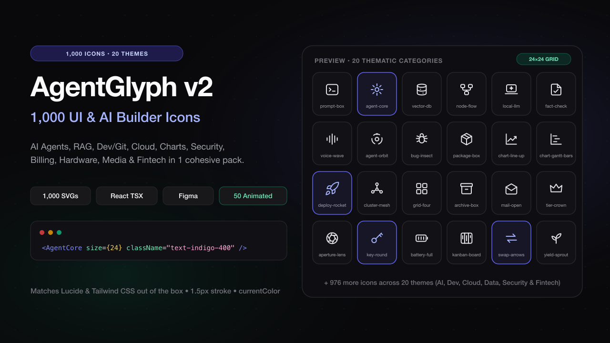

# AgentGlyph v2 — 1,000 UI, AI & SaaS Icons

  

**AgentGlyph v2** is a 24×24px, `1.5px` stroke icon system engineered for AI apps, developer tools, and full-stack SaaS dashboards — designed to pair 1:1 with **Lucide** and **Tailwind CSS**.

## Free Starter Pack Included Here (`svg/`)

This repository includes **40 Free Lite SVG icons** (2 curated icons from every one of the 20 themes) ready to copy or clone into commercial projects.

- **Free Lite ZIP (Gumroad):** https://5418582126609.gumroad.com/l/yrwls
- **Full Pro v2 (1,000 Icons + 1,000 React TSX + 50 Animated States + Figma):** https://5418582126609.gumroad.com/l/aqhwe *(50% off early-bird with code `EARLY50`)*
- **Figma Master Preview:** https://www.figma.com/design/YL2BMhqeuJAUthScdj4hJs

## Deploying to GitHub Pages (Free Static Host)

1. Push this directory as a public GitHub repository (e.g., `agentglyph`).
2. Open **Settings → Pages → Build and deployment**:
   - **Source:** `Deploy from a branch`
   - **Branch:** `main` / `/(root)`
3. Wait ~30 seconds — your live Freemium 1,000-icon explorer is online at `https://<username>.github.io/<repo>/`.

> **IP Protection:** Only the 40 Free Lite SVGs are shipped as raw vector source in `svg/` and `manifest-public.js`. The remaining 960 Pro icons are displayed interactively via PNG sprite masks in `sprites/`.
